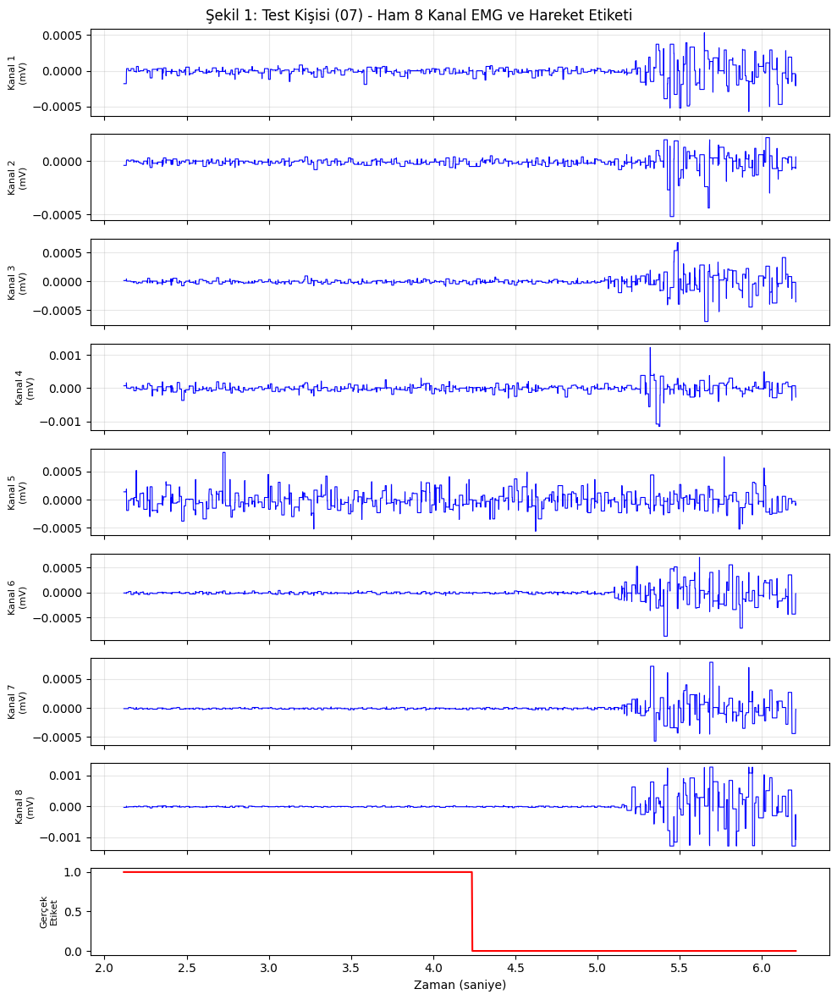
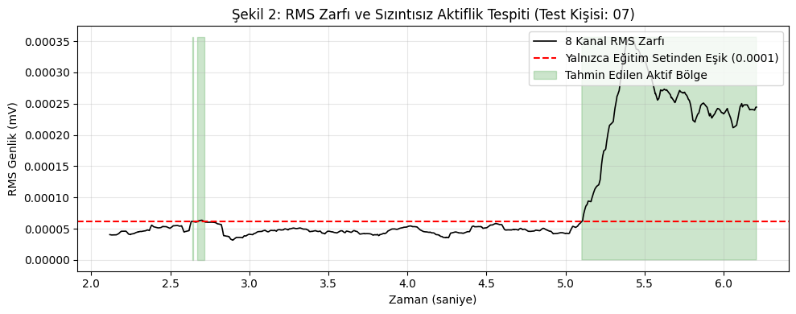
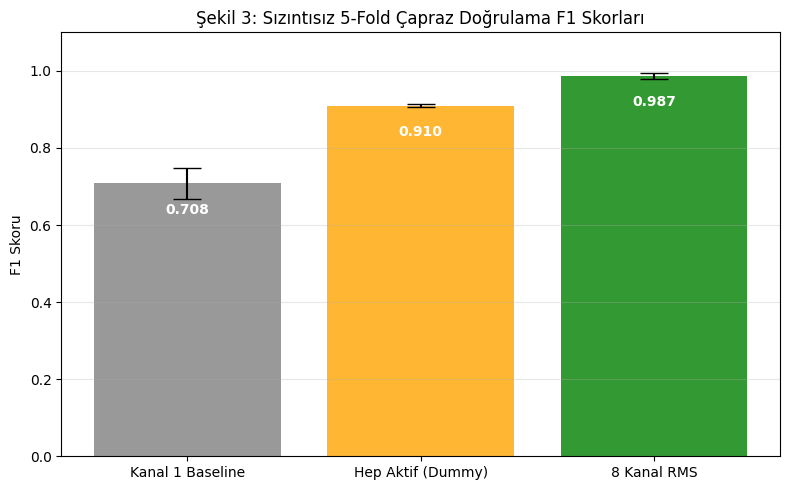

# 8 Kanallı Kol EMG Sinyallerinde Eşikleme ile Aktif / Dinlenme Ayrımı

**Araştırma Sorusu:** 8 kanallı kol EMG verilerinden, kasın aktif ve dinlenme durumları makine öğrenmesi kullanılmadan, eşikleme yöntemleriyle örnek bazında ayrılabilir mi?

**Proje Özeti:**
 İlk aşamada UCI veri setindeki `'01'` numaralı kişinin (`1_raw_data_13-12_22.03.16.txt`) `time`, `channel1`–`channel8` ve `class` sütunları incelenmiş; vize aşamasında ise veri sızıntısını önlemek amacıyla 36 kişinin tamamına ait 72 kayıt dosyası kişi bazlı 5 katlı çapraz doğrulama (`GroupKFold`) ile değerlendirilmiştir.

Baseline F1 skoru, sadece 1. kanalın mutlak değerini alıp belirlediğimiz bir eşik değeriyle karşılaştırarak bulduğumuz tahminlerin, gerçek `class` etiketleriyle kıyaslanmasıyla hesaplanıyor. Eşik değeri ise, eğitim kümesindeki kişilerin sadece dinlenme durumunu ifade eden (`class 1`) kısımlarının ortalamasına, standart sapmasının 3 katı eklenerek bulunuyor. Baseline skorumuz (`0.708 ± 0.039`), 'hep aktif' skorumuzdan (`0.910 ± 0.004`) daha düşük çıktı; bu da 1. kanaldaki basit eşikleme yönteminin yetersiz kaldığını, 8 kanal RMS zarfı (`0.987 ± 0.007`) kullanıldığında ise kişiler arası güçlü bir aktif/dinlenme ayrımı sağlandığını gösteriyor.

## Veri Seti
* **Adı:** EMG data for gestures
* **Bağlantı:** [UCI Machine Learning Repository](https://archive.ics.uci.edu/dataset/481/emg+data+for+gestures)
* **Not:** Veri seti, kod çalıştığında otomatik olarak UCI sunucularından indirilmektedir. Veri boyutu ve kurallar gereği ham veri dosyaları bu depoya dahil edilmemiştir.

## Nasıl Çalıştırılır?
1. Bu depoyu (repository) bilgisayarınıza indirin.
2. Depodaki `EEM4011_EMG_Projesi.ipynb` not defterini Google Colab'a yükleyin.
3. Colab üst menüsünden `Çalışma zamanı (Runtime)` -> `Yeniden başlat ve tümünü çalıştır (Restart and run all)` seçeneğine tıklayın.

## Proje Sonuçları

**Kişi Bazlı Sonuç Tablosu (5-Fold GroupKFold Ortalama ± Sapma)**

| Yöntem | F1 Skoru (Test Kişilerinde) |
| :--- | :--- |
| **Kanal 1 Baseline** | 0.708 ± 0.039 |
| **Hep Aktif (Dummy)** | 0.910 ± 0.004 |
| **8 Kanal RMS** | 0.987 ± 0.007 |

**Açıklama:** Önceki aşamada tek bir kayıt üzerinden elde edilen 1.000 F1 skoru, eşiğin hesaplandığı veri ile testin yapıldığı verinin aynı olmasından kaynaklı 'örneklem içi' (in-sample) bir değerken; güncel tablodaki 0.987 ± 0.007 skoru, modelin daha önce hiç görmediği kişilerden oluşan 5 farklı test grubunda sızıntısız olarak elde ettiği gerçek başarıdır.

## Kapsam ve Sınırlılıklar
* **Class 0 hariçtir:** Veri setinde hareket geçişlerindeki işaretsiz bölgeleri temsil eden `class 0` satırları F1 hesabından dışarıda bırakılmıştır (`class 1`: dinlenme, `class 2–7`: aktif hareket).
* **Örnek bazlı aktif/dinlenme ayrımı:** Bu çalışmada hareketin başlangıç anı gecikmesi (onset) değil, her zaman örneği için aktif/dinlenme ikili ayrımı (F1 skoru) ölçülmüştür.

## Jüri Şekilleri

*Şekil 1: Modelin daha önce hiç görmediği bir test kişisine ait ham 8 kanal EMG sinyalleri ve gerçek hareket etiketleri.*

*Şekil 2: Aynı test kişisinde hesaplanan 8 kanal RMS zarfı, yalnızca eğitim kişilerinden elde edilen eşik çizgisi ve tahmin edilen aktif bölgeler.*

*Şekil 3: Veri sızıntısı engellenerek yapılan 5 katlı kişi bazlı çapraz doğrulama (GroupKFold) sonucunda yöntemlerin ortalama F1 skoru karşılaştırması.*

## Atıf
Bu projede kullanılan veri seti için orijinal makale atıfı:
Krilova, N., Kastalskiy, I., Kazantsev, V., Makarov, V., & Lobov, S. (2018). EMG Data for Gestures [Dataset]. UCI Machine Learning Repository. https://doi.org/10.24432/C5ZP5C.

## Lisans
Bu depodaki analiz kodları **MIT Lisansı** ile açık kaynak olarak paylaşılmıştır.
